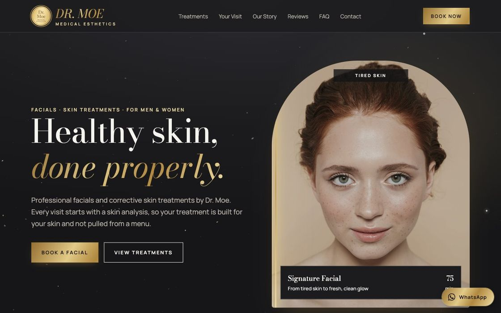

# Dr. Moe Medical Esthetics — Website & Business Tools

**Live site:** [drmoe.netlify.app](https://drmoe.netlify.app)

A luxury website for **Dr. Moe Medical Esthetics**, a facial and skin-treatment studio in Windsor, Ontario. Alongside the public site, I built two private business tools the owner uses day to day: a receipt maker and a sales dashboard.



## What's included

### 1. Public website — `index.html`
- **Treatment menu** with prices for facials, peels and skin services, including men's treatments
- **"Your Visit"** four-step guide: consultation, skin analysis, treatment and home-care plan
- **Founder's story** with credentials and languages spoken
- **Online booking form** with treatment, date and time preferences, an optional female-esthetician request and a deposit policy
- **Client reviews** with a submission form, plus an **FAQ** on payments, deposits and cancellations
- **Contact options:** phone, WhatsApp, email and Instagram

### 2. Receipt maker — `receipt.html`
- Creates branded, printable client receipts
- Saves each receipt to a local business log and submits a copy through Netlify Forms

### 3. Business dashboard — `dashboard.html`
- Revenue by day, treatment breakdown and payment methods
- Busiest days, top clients and automatic insights
- Filter by period, plus backup and restore of the receipt log

## Tech stack

| Area | Tools |
|---|---|
| Front end | HTML5, CSS3, vanilla JavaScript |
| Data | Browser `localStorage` (no server or database needed) |
| Forms | Netlify Forms |
| Hosting | Netlify |

## Run locally

No build step. Open `index.html` in a browser, or serve the folder:

```bash
npx serve .
```

---

Designed and developed by **Manar Altumah** · [Portfolio](https://manar-altumah.netlify.app) · [LinkedIn](https://www.linkedin.com/in/manar-a-4b776030a)

## License

© 2026 Manar Altumah. **All rights reserved.** This code is shared for portfolio viewing only and may not be copied, reused or sold. See [LICENSE](LICENSE).
